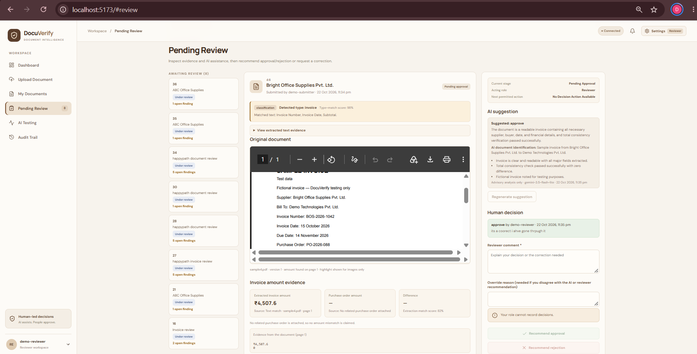
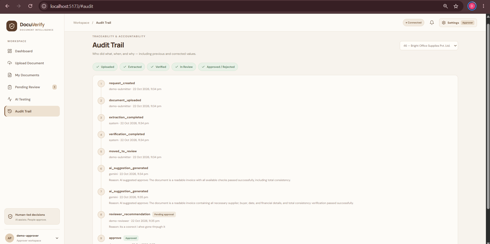
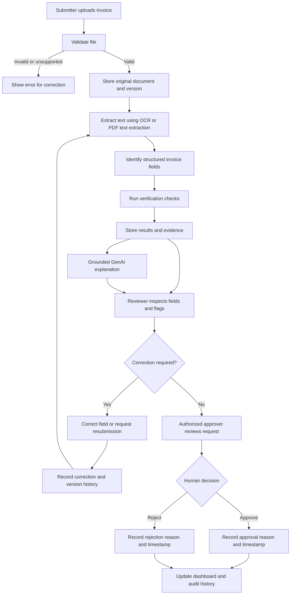
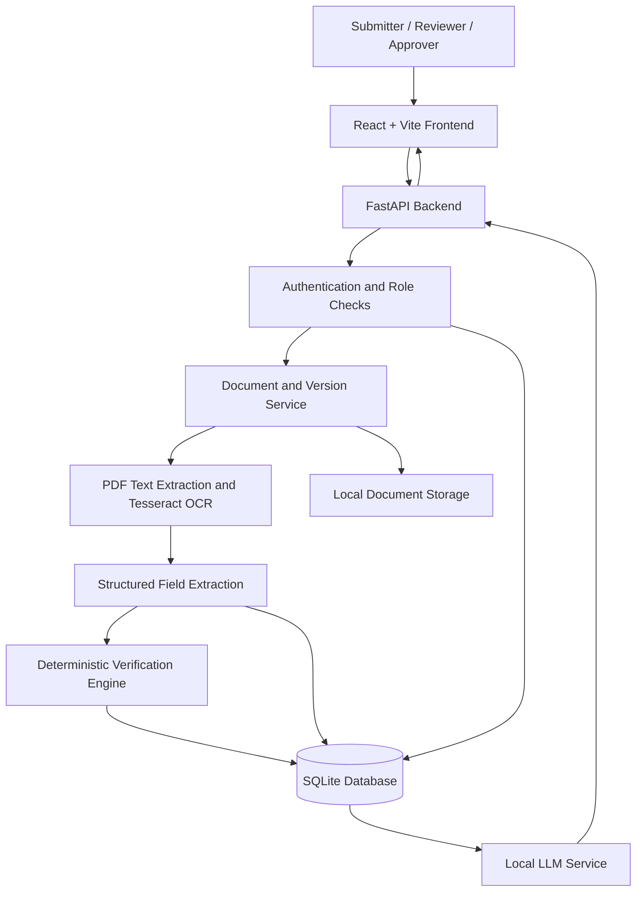
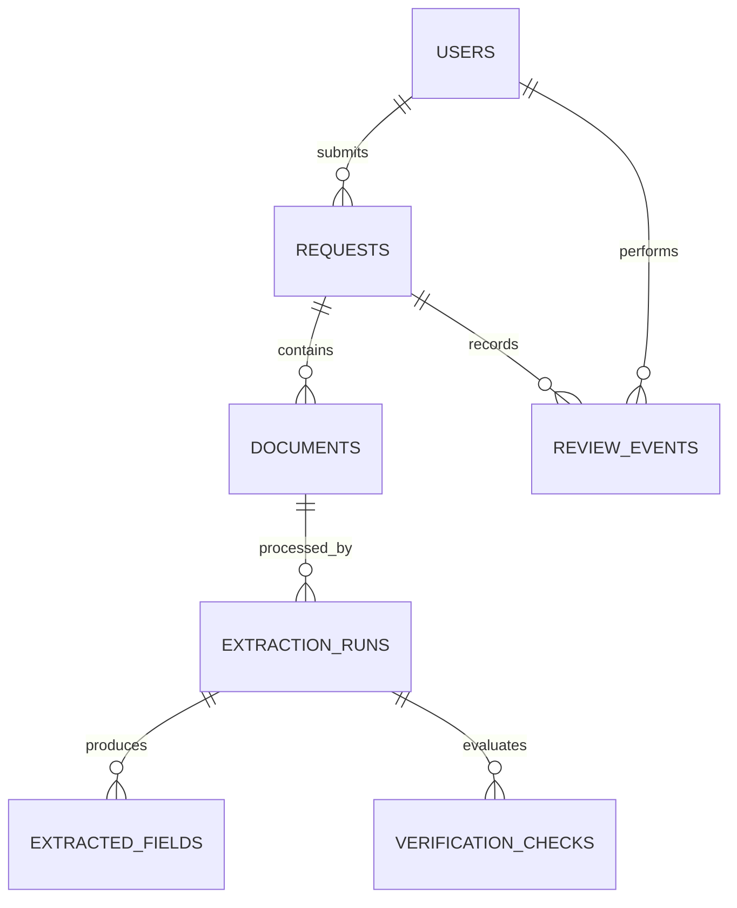

# DocuVerify AI
### Evidence-First Document Verification & Approval System


<p align="center">
  
</p>

<p align="center">
  
</p>

---

**GitHub Repository:** https://github.com/divyadhotre/Buildathon_2.0

**Team:** DayBreak  
**Event:** Buildathon 2.0  
**Institution:** Walchand Institute of Technology, Solapur  
**Problem Statement:** PS 02 — Document Verification & Approval System  
**Primary Use Case:** Invoice Verification  
**Project Status:** Initial scaffold prepared · Implementation in progress

> **Our vision:** Make document verification more transparent, traceable, and efficient by connecting every verification flag to evidence, preserving document history, and keeping final approval decisions in human hands.

---

## Table of Contents

- [1. Overview](#1-overview)
- [2. Problem Statement](#2-problem-statement)
- [3. Our Proposed Solution](#3-our-proposed-solution)
- [4. Key Features](#4-key-features)
- [5. What Makes DocuVerify AI Different](#5-what-makes-docuverify-ai-different)
- [6. End-to-End Workflow](#6-end-to-end-workflow)
- [7. System Architecture](#7-system-architecture)
- [8. Technology Stack](#8-technology-stack)
- [9. Verification Strategy](#9-verification-strategy)
- [10. Data and Database Design](#10-data-and-database-design)
- [11. Planned API Design](#11-planned-api-design)
- [12. Grounded GenAI Assistance](#12-grounded-genai-assistance)
- [13. User Roles and Permissions](#13-user-roles-and-permissions)
- [14. Evaluation and Success Metrics](#14-evaluation-and-success-metrics)
- [15. Responsible AI and Security](#15-responsible-ai-and-security)
- [16. Current Implementation Status](#16-current-implementation-status)
- [17. Development Roadmap](#17-development-roadmap)
- [18. Local Setup](#18-local-setup)
- [19. Testing Strategy](#19-testing-strategy)
- [20. Demonstration Plan](#20-demonstration-plan)
- [21. Team Structure](#21-team-structure)
- [22. Future Scope](#22-future-scope)
- [23. Repository Structure](#23-repository-structure)

---

## 1. Overview

DocuVerify AI is an AI-assisted document verification and approval system for reviewing business documents through a structured, evidence-driven workflow. Invoice checks are a specialized ruleset; other and unfamiliar document types can still be uploaded, classified where possible, inspected, and reviewed.

The system aims to combine document text extraction, structured field identification, deterministic verification rules, reviewer corrections, version history, role-based decisions, and evidence-grounded GenAI explanations in one workflow.

Rather than treating a document as simply valid or invalid, DocuVerify AI is designed to show:

- What information was extracted.
- Which verification checks passed or raised an issue.
- What evidence supports each issue.
- What a reviewer corrected and why.
- How a document changed across resubmissions.
- Who made the final decision and when.

**Core principle:** AI assists verification; authorized humans retain control over approval and rejection.

The intake and review workflow is document-type agnostic. Deterministic invoice checks run only when the document is confidently classified as an invoice; the system does not apply invoice requirements to unrelated documents.

## 2. Problem Statement

### PS 02 — Document Verification & Approval System

Document processing often involves receiving documents, extracting information, checking requirements, identifying issues, requesting corrections, and tracking approval decisions.

When these activities are handled through disconnected or manual workflows, reviewers may need to repeatedly inspect documents, compare values, communicate corrections, and reconstruct the history of a decision.

A useful verification system needs to do more than extract text. It must connect extracted information to meaningful checks, make problems understandable, preserve document versions, and support accountable human decisions.

### The challenge

Build a system that can:

1. Receive documents and extract relevant information.
2. Run at least two verification checks.
3. Highlight issues with supporting evidence.
4. Support corrections and resubmissions.
5. Preserve original documents, versions, extracted values, and reviewer corrections.
6. Allow authorized humans to approve or reject documents with reasons and timestamps.
7. Provide a dashboard and search functionality.
8. Enforce appropriate role-based permissions.
9. Use a learned component, such as existing OCR and structured extraction.
10. Generate grounded explanations or correction messages using stored evidence.
11. Introduce a team-designed innovation and evaluate its value.

DocuVerify AI implements this workflow for common business documents, with invoice arithmetic and required-field checks as its first specialized ruleset.

## 3. Our Proposed Solution

DocuVerify AI provides a traceable review workflow for uploaded documents, with specialized invoice verification where the evidence supports it.

### Proposed workflow

**Upload → Extract → Verify → Review → Correct → Decide → Track**

1. **Upload:** A submitter uploads a PDF, PNG/JPG/JPEG, TXT, or DOCX document. Type selection is not required.
2. **Extract:** The system extracts document text and type-aware invoice, purchase order, receipt, or contract fields, while retaining generic labelled fields.
3. **Verify:** Configured checks run only when supported by the detected type and available evidence.
4. **Review:** A reviewer inspects flagged issues alongside the available evidence.
5. **Correct:** Incorrect extracted values can be corrected, or the submitter can be asked to provide a revised document.
6. **Track:** Original files, versions, extraction results, corrections, and review events are retained.
7. **Decide:** An authorized approver makes the final decision and records a reason.
8. **Explain:** Optional Gemini assistance analyzes bounded extracted text, fields, and verification evidence; it can withhold an action when no safe recommendation is supported.

A failed extraction, unreadable document, or incomplete check must not be treated as successful verification. Processing failures should be surfaced for review rather than resulting in automatic approval.

## 4. Key Features

The following features describe the intended product. Their implementation status is tracked separately in Section 16.

### 4.1 Document intake

- Upload PDF, PNG, JPG, JPEG, TXT, and DOCX documents without requiring a fixed category.
- Validate actual file content, supported file type, and file size.
- Store uploaded documents for processing.
- Associate uploads with a request and version.
- Provide understandable errors for unsupported or unreadable files.

### 4.2 OCR and structured extraction

- Extract text from digital PDFs, plain text, and DOCX files; use Tesseract for scanned PDF pages and supported images.
- Detect common document types from text while keeping unknown documents available for review.
- Extract common structured fields for invoices, purchase orders, receipts, and contracts, retaining generic labelled fields as additional evidence.
- Identify relevant transaction fields, such as:
  - Supplier name
  - Invoice, purchase order, or transaction number and date
  - Subtotal
  - Tax
  - Total amount
  - Readable line items, quantities, and prices
- Identify contract parties, dates, values, payment terms, and clearly worded obligations when present.
- Retain the original extracted values.
- Make uncertain or missing fields visible to reviewers.

### 4.3 Evidence-linked verification

- Execute configured verification rules.
- Show the result of each check.
- Explain why a check raised an issue.
- Link flags to relevant extracted values and available source evidence.
- Distinguish confirmed rule violations from possible matches or uncertain extraction.

### 4.4 Human review and corrections

- Present extracted fields and verification results in a review interface.
- Allow authorized reviewers to correct extracted values.
- Preserve the original extraction separately from reviewer corrections.
- Record correction history.
- Support requests for resubmission.

### 4.5 Version and audit history

- Retain the original uploaded document.
- Associate each resubmission with a distinct document version.
- Record extraction runs and reviewer edits.
- Record review actions, decisions, reasons, actors, and timestamps.
- Make the history available to authorized users.

### 4.6 Approval workflow

- Separate submission, review, and approval responsibilities.
- A reviewer records an approval or rejection recommendation; the request then moves to the approver queue for the final decision.
- Require an override reason when the approver's final decision differs from the reviewer's recommendation.
- Support correction requests that return to the submitter; a resubmission creates a new version on the same request and restarts review.
- Support approval or rejection by authorized users.
- Require a decision reason where applicable.
- Prevent submitters from approving their own requests.
- Keep unresolved or failed checks visible.

### 4.7 Dashboard and search

The planned dashboard will provide visibility into:

- Total requests.
- Requests awaiting review.
- Requests requiring correction.
- Approved and rejected requests.
- Processing failures.
- Searchable requests and their current status.

Dashboard counts will be derived from stored application data rather than hard-coded demonstration values.

### 4.8 GenAI-assisted explanations

- Generate concise explanations for verification issues.
- Draft correction requests using the relevant evidence.
- Reference the fields and checks that support the explanation.
- Avoid inventing missing values or claiming that an invoice is authentic.

---

## 5. What Makes DocuVerify AI Different

Our proposed differentiator is **evidence-linked verification combined with measurable reviewer effort**.

Many basic prototypes stop after extracting fields or displaying a red warning. DocuVerify AI aims to make the reason behind a warning inspectable and to evaluate whether this presentation helps reviewers work more efficiently.

### Innovation 1: Evidence-linked flags

Each verification flag should connect to the relevant field, rule, and available source evidence.

For example, if the extracted subtotal and tax do not match the extracted total, the interface should show the values used in the calculation and the resulting discrepancy.

This makes the flag explainable and allows a reviewer to inspect the underlying evidence.

### Innovation 2: Original extraction versus reviewer correction

The system is designed to retain both the original extracted value and the corrected value.

This allows the team to investigate:

- Which fields OCR extracted incorrectly.
- Which corrections reviewers made.
- How often particular extraction problems occur.
- Whether extraction quality improves after changes to the pipeline.

Reviewer corrections will not silently overwrite the original extraction record.

### Innovation 3: Reviewer correction-time measurement

We plan to measure the time required to resolve verification issues and compare it with a clearly defined baseline workflow.

The evaluation will consider the time needed to inspect a flag, identify the supporting evidence, and resolve the issue.

Any improvement will be reported only after measurement on a defined test set. We will not claim time savings before collecting results.

### Innovation goal

Build a system that makes document verification **more understandable, auditable, and measurable**, rather than presenting AI output as unquestionable truth.

---

## 6. End-to-End Workflow



The diagram describes the intended workflow, not a claim that all steps are already implemented.

### Example scenario

Suppose an uploaded invoice contains:

- Subtotal: ₹1,000
- Tax: ₹180
- Total: ₹1,250

The amount-consistency check would compare the subtotal plus tax against the extracted total. Here, ₹1,000 + ₹180 = ₹1,180, which differs from ₹1,250 by ₹70.

The system should flag the discrepancy and display the values used in the calculation. It should not automatically declare the invoice fraudulent or reject it. A reviewer must inspect the document and determine the next action.

---

## 7. System Architecture

The planned architecture separates the user interface, API layer, document processing, verification logic, and persistent data.



### Component responsibilities

| Component | Responsibility |
|---|---|
| React + Vite | Upload interface, dashboard, review queue, flags, corrections, and history |
| FastAPI | API endpoints, request validation, workflow coordination, and access checks |
| SQLAlchemy | Database models and persistence layer |
| SQLite | Local prototype data store |
| PDF text extraction | Extract embedded text from supported PDFs |
| Tesseract OCR | Extract text from supported scanned documents and images |
| Extraction service | Convert extracted text into structured invoice fields |
| Verification engine | Apply explicit rules and generate results with evidence |
| Local LLM | Draft evidence-grounded explanations and correction messages |
| Document storage | Retain uploaded files and their versions |

The local LLM is intended to assist with explanations, not replace deterministic checks or authorized human decisions.

---

## 8. Technology Stack

| Technology | Planned use |
|---|---|
| React | Frontend components and interface |
| Vite | Frontend development and build tooling |
| FastAPI | Python backend and REST API |
| Python | Document processing and verification logic |
| SQLite | Database for the initial prototype |
| SQLAlchemy | Database models and ORM |
| Tesseract OCR | OCR for supported scanned documents and images |
| PyMuPDF | PDF text extraction, where needed |
| Gemini API (optional) | Evidence-grounded reviewer suggestions |
| Git and GitHub | Version control, collaboration, and project tracking |

### Why this stack?

- **Rapid development:** React and FastAPI support independent frontend and backend development.
- **Practical document processing:** PDF text extraction and OCR cover common digital and scanned invoice inputs.
- **Transparent verification:** Deterministic rules make financial checks easier to test and explain.
- **Local prototype:** SQLite reduces setup complexity during the buildathon.
- **Human oversight:** A reviewer-facing workflow avoids treating model output as an automatic final decision.

AI assistance can use the configured `GEMINI_MODEL`; without `GEMINI_API_KEY`, the application provides a clearly labelled local evidence summary rather than failing or claiming that Gemini ran.

---

## 9. Verification Strategy

The verification engine will use explicit, testable rules rather than relying on an LLM to decide whether an invoice passes.

### Check 1: Required-field validation

**Purpose:** Identify missing or unusable key fields.

Candidate required fields:

- Supplier name
- Invoice number
- Total amount

**Example result:** `Needs review — Total amount could not be extracted reliably.`

A field that is unreadable or uncertain should not be silently treated as a valid value.

### Check 2: Amount consistency

**Purpose:** Compare the subtotal, tax, and total when the necessary values are available.

Simplified rule:

`Expected total = Subtotal + Tax`

`Difference = Extracted total - Expected total`

A configurable tolerance may be used for rounding differences. The tolerance and treatment of discounts, fees, and other invoice adjustments must be explicitly defined and tested.

**Example result:** `Needs review — Extracted total differs from subtotal plus tax.`

### Check 3: Possible duplicate invoice

**Purpose:** Identify possible duplicate submissions using available identifiers, such as supplier name and invoice number.

A match should be presented as a **possible duplicate**, not proof of fraud. Legitimate resubmissions and corrected versions must be distinguished from separate invoices.

### Check-result design

Each check is intended to store:

- Check identifier and rule version.
- Result: pass, flag, or unable to determine.
- Relevant field values.
- Expected and observed values where applicable.
- Evidence reference.
- Human-readable explanation.
- Processing timestamp.

A missing field should result in an unresolved check rather than a false pass. A failed processing step must not result in automatic approval.

---

## 10. Data and Database Design

The initial database will use SQLite with SQLAlchemy. The following entities describe the planned logical schema; the final models may be refined during implementation.

| Entity | Purpose |
|---|---|
| `users` | User identity and role information |
| `requests` | Verification request, submitter, current status, and timestamps |
| `documents` | Uploaded files, version numbers, storage paths, and file metadata |
| `extraction_runs` | OCR/extraction attempts, status, and timestamps |
| `extracted_fields` | Field name, original extracted value, confidence if available, and corrected value reference |
| `verification_checks` | Rules executed, results, values compared, and evidence references |
| `review_events` | Corrections, resubmission requests, decisions, reasons, actors, and timestamps |

### Data integrity principles

- Preserve the original uploaded file.
- Associate resubmissions with explicit document versions.
- Retain original extracted values when a reviewer corrects them.
- Record who made a correction and when.
- Store verification results against the document version and extraction run they evaluated.
- Make the current request status consistent with the latest applicable workflow events.
- Restrict access to documents and review history according to user permissions.

### Example relationship model



The schema is a design target; actual relationships and constraints will be documented as the models are implemented.

---

## 11. Planned API Design

The backend will expose REST endpoints through FastAPI. The following routes are the proposed API contract and should not be interpreted as already available unless implemented and tested.

| Method | Endpoint | Purpose |
|---|---|---|
| `GET` | `/api/health` | Check API availability |
| `POST` | `/api/requests` | Create a verification request |
| `GET` | `/api/requests` | List and search requests |
| `GET` | `/api/requests/{id}` | Retrieve request details |
| `POST` | `/api/requests/{id}/documents` | Upload a document version |
| `POST` | `/api/documents/{id}/process` | Trigger extraction and verification |
| `PATCH` | `/api/requests/{id}/fields` | Submit permitted field corrections |
| `POST` | `/api/requests/{id}/corrections` | Record a correction or request resubmission |
| `POST` | `/api/requests/{id}/decisions` | Record an authorized approval or rejection |
| `GET` | `/api/requests/{id}/history` | Retrieve authorized history |
| `GET` | `/api/dashboard/summary` | Retrieve dashboard counts |
| `POST` | `/api/requests/{id}/explanation` | Generate an evidence-grounded explanation |

### API design principles

- Validate request payloads and file types.
- Return understandable errors for failed processing.
- Enforce authorization on protected operations.
- Prevent unauthorized status transitions.
- Associate processing results with the correct document version.
- Record relevant actions for auditability.
- Avoid returning sensitive document data to unauthorized users.

The API contract will be updated alongside the implementation to keep frontend and backend development aligned.

---

## 12. Grounded GenAI Assistance

DocuVerify AI is intended to use a local language model for reviewer assistance.

### Planned capabilities

1. Summarize verification flags in plain language.
2. Draft correction requests for missing or inconsistent fields.
3. Explain a discrepancy using the stored values and rule result.
4. Identify the supporting evidence references used in the explanation.

### Grounding approach

The model should receive only the relevant current request data, extracted values, verification results, and evidence references that the requesting user is authorized to access.

The response should be checked against the supplied evidence before being shown. If the necessary evidence is missing, the system should state that the issue could not be explained reliably rather than inventing a reason.

### Example

**Verification result:** Subtotal ₹1,000 + tax ₹180 does not equal the extracted total ₹1,250.

**Expected explanation:** The extracted subtotal and tax add up to ₹1,180, while the extracted total is ₹1,250. The difference is ₹70. Please verify the invoice values and any additional charges.

This example illustrates the intended behavior; it is not a claim that the LLM integration is already implemented.

### Important boundary

The LLM will not independently approve or reject documents, determine authenticity, or override verification evidence and human decisions.

---

## 13. User Roles and Permissions

The intended system separates responsibilities among three roles.

| Role | Planned permissions |
|---|---|
| Submitter | Create requests, upload documents, view permitted status information, and respond to correction requests |
| Reviewer | Inspect extracted values and evidence, resolve review issues, submit corrections, and request resubmission |
| Approver/Admin | Review eligible requests, approve or reject with a reason, and perform authorized administrative actions |

### Access-control requirements

- A submitter must not approve their own request.
- Only authorized roles can perform approval or rejection.
- Users should access only requests and documents permitted by their role.
- Rejected or approved decisions must be traceable to the responsible user.
- Failed extraction or unresolved checks must not be silently treated as approval.

Role-based authorization will be implemented and tested before being described as functional.

---

## 14. Evaluation and Success Metrics

We will evaluate the system using a defined test set rather than relying only on a successful demonstration.

### Planned evaluation areas

| Metric | What it measures | Evaluation approach |
|---|---|---|
| Field extraction accuracy | Correctly extracted invoice fields | Compare extracted fields against manually verified reference values |
| Required-field check accuracy | Correct detection of missing required fields | Test invoices with known missing, readable, and unreadable fields |
| Amount-check correctness | Correct identification of amount inconsistencies | Test matching totals, mismatches, and rounding cases |
| Duplicate detection quality | Quality of possible duplicate flags | Evaluate known duplicate and non-duplicate examples |
| Evidence coverage | Whether flags include usable supporting evidence | Audit generated flags against their source values and rules |
| Correction traceability | Whether original values and corrections remain distinguishable | Test correction and resubmission histories |
| Decision auditability | Whether decisions record actor, reason, and timestamp | Test authorized approval and rejection flows |
| Reviewer correction time | Time required to resolve review issues | Compare a defined baseline with the evidence-linked interface |
| Processing reliability | How often the pipeline completes or reports a useful failure | Run valid, unsupported, corrupted, and difficult-to-read files |

### Measurement discipline

- Define the test set and reference answers before reporting performance.
- Separate extraction failures from verification-rule errors.
- Report sample size and test conditions alongside metrics.
- Record the actual results after implementation.
- Avoid reporting unsupported accuracy percentages or time-saving claims.

The team will prioritize measurable correctness, explainability, and workflow reliability over unverified performance claims.

---

## 15. Responsible AI and Security

Document verification can affect financial and administrative decisions. DocuVerify AI is therefore designed with explicit safeguards.

### Human oversight

- Approval and rejection remain human decisions.
- AI-generated explanations are advisory.
- Unresolved checks remain visible to reviewers.
- Processing errors must not lead to automatic approval.

### Data integrity

- Original files and versions should be preserved.
- Corrections should be recorded as separate review events.
- Verification results should reference the data and version used.
- Decision history should remain traceable.

### Application security

- Validate uploaded file type and size.
- Use safe server-side file handling.
- Restrict access to uploaded documents and review actions.
- Store secrets in environment variables rather than source code.
- Exclude `.env`, private documents, and credentials from Git.
- Avoid logging confidential document contents unnecessarily.
- Use synthetic or sanitized invoices for public demonstrations.

### Limits of verification

A passed arithmetic or required-field check does not establish that an invoice is genuine. A possible duplicate does not prove fraud. OCR may misread text, and language models may produce incorrect explanations.

DocuVerify AI will communicate these limitations and rely on authorized human review for final decisions.

---

## 16. Current Implementation Status

The repository contains a working document-review prototype. The dashboard, review queue, document detail, audit history, measured evaluation report, and settings read from backend data or configuration rather than using demonstration-only records.

| Component | Current status |
|---|---|
| PDF, PNG/JPG/JPEG, TXT, and DOCX upload | Implemented with format and size validation |
| PDF, TXT, and DOCX text extraction; image/scanned-page OCR | Implemented; scanned content requires a local Tesseract installation |
| Document classification | Implemented for common patterns, with an unknown/generic path |
| Structured extraction | Type-aware invoice, purchase order, receipt, and contract fields plus generic labelled fields |
| Deterministic verification | Invoice/PO/receipt arithmetic and required-field checks; contract metadata and obligation coverage findings |
| Human review, field corrections, and decisions | Implemented with role checks and audit events |
| AI suggestions | Optional Gemini integration uses bounded text and evidence; unsupported actions are withheld |
| Dashboard, repository, review queue, and audit | Connected to persisted API data |
| Evaluation report | Reads measured test-run results and real review-time samples |
| Authentication | Demo identity headers only; not production authentication |

AI output remains advisory and does not alter request status or replace human decisions. Submitters can request an analysis of their own upload but still cannot make the final decision. For an unfamiliar document type or unsupported check, Gemini can explain the available evidence while withholding a decision action; without a key, the local evidence summary keeps that workflow usable.

### Progress policy

We will use these labels consistently:

- **Implemented:** Built and verified through an appropriate test.
- **In Progress:** Implementation has started but is not yet complete.
- **Planned:** Designed or scoped, but implementation has not started.
- **Blocked:** Cannot proceed until a stated dependency is resolved.

A design document or UI mock-up alone does not make a backend or processing feature implemented.

---

## 17. Development Roadmap

The work will proceed in small, testable increments.

### Phase 1 — Repository and integration foundation

- Commit the initial scaffold.
- Agree on API request and response formats.
- Establish branch ownership and pull-request workflow.
- Verify that the frontend and backend start locally.

**Deliverable:** A reproducible project foundation.

### Phase 2 — Document intake and extraction

- Implement safe document upload.
- Store the original file and document version.
- Extract text from supported PDFs and images.
- Parse the initial invoice fields.
- Handle unreadable and unsupported documents.

**Deliverable:** An uploaded sample invoice with inspectable extraction output.

### Phase 3 — Verification and evidence

- Implement required-field validation.
- Implement amount consistency checks.
- Add possible duplicate detection if time permits.
- Store check results and supporting values.
- Test positive, negative, and uncertain cases.

**Deliverable:** Verification results with clear reasons and evidence.

### Phase 4 — Review and audit trail

- Build the review interface.
- Allow authorized field corrections.
- Preserve original extraction values.
- Add correction and resubmission history.
- Implement human approval and rejection with reasons.

**Deliverable:** A traceable review and decision workflow.

### Phase 5 — Dashboard and GenAI

- Connect dashboard counts to backend data.
- Add request search and status filters.
- Integrate the selected local language model.
- Ground explanations in stored evidence.
- Validate outputs against known cases.

**Deliverable:** A connected dashboard and evidence-grounded reviewer assistance.

### Phase 6 — Testing and demonstration

- Test the complete workflow.
- Test role restrictions and invalid files.
- Measure extraction and verification performance.
- Evaluate reviewer correction time using a defined baseline.
- Update screenshots, documentation, and known limitations.

**Deliverable:** A reproducible prototype demonstration with honest evaluation results.

Features will be prioritized by the team according to the actual buildathon deadline and integration progress.

---

## 18. Local Setup

These instructions describe the intended development environment. Commands may need minor adjustments as dependencies and application entry points are finalized.

### Prerequisites

- Python 3.10 or a compatible supported version.
- Node.js and npm.
- Git.
- Tesseract OCR installed separately if OCR is enabled.
- An optional Gemini API key (`GEMINI_API_KEY`) for AI suggestions.

### 1. Clone the repository

After the GitHub repository is created:

git clone https://github.com/divyadhotre/Buildathon_2.0.git
cd Buildathon_2.0

### 2. Set up the backend

```bash
cd backend
python -m venv .venv
```

Activate the environment on Windows:

```powershell
.venv\Scripts\Activate.ps1
```

If PowerShell blocks activation, use Command Prompt:

```bat
.venv\Scripts\activate.bat
```

Install the declared dependencies:

```bash
pip install -r requirements.txt
```

Start the API from the `backend` directory:

```bash
uvicorn app.main:app --reload
```

If the application is running with the expected configuration, the FastAPI interactive documentation will typically be available at:

`http://127.0.0.1:8000/docs`

### 3. Set up the frontend

Open a second terminal:

```bash
cd frontend
npm install
npm run dev
```

Open the local URL printed by Vite in the terminal.

### 4. Configure local services

- Install Tesseract OCR and make it available on `PATH`, or set `TESSERACT_CMD`, for scanned PDFs and image uploads.
- To enable Gemini suggestions, copy `backend/.env.example` to `backend/.env` and set `GEMINI_API_KEY`. The template uses `gemini-3.8-flash`; check the model ID and quota for the Google project that owns the key. Without a key, the app displays a clearly labelled local evidence summary instead.
- Keep local settings and secrets in environment files that are excluded from Git.
- Use synthetic invoice documents during development and demonstration.

After changing `backend/.env`, restart Uvicorn. For AI errors, `401`/`403` indicate key or permission issues, `404` indicates an unavailable model ID, and `429` indicates a rate or quota limit. A `503` mentioning DNS, timeout, TLS, or an OS error points to the backend machine's network, proxy, or firewall; it is not fixed by deleting requests or replacing a key in the same project.

Run the focused backend tests from `backend` with `python -m pytest tests -q`. Run the frontend production build from `frontend` with `npm run build`.

### Setup status

The repository contains a working prototype for PDF/image/TXT/DOCX upload, generic document extraction, type-gated verification, role-guarded review decisions, audit history, and optional Gemini suggestions. OCR for scanned documents depends on a local Tesseract installation, and demo role headers are not production authentication.

---

## 19. Testing Strategy

Testing will cover both individual components and the complete workflow.

### Document-processing tests

- Supported digital PDF.
- Scanned invoice image.
- Missing required field.
- Unreadable or low-quality document.
- Unsupported file type.
- Corrupted document.
- Failed OCR or extraction.

### Verification tests

- Subtotal plus tax equals total.
- Total differs from the expected amount.
- Rounding tolerance boundary.
- Missing amount values.
- Possible duplicate and non-duplicate invoices.

### Workflow tests

- Upload and processing.
- Field correction.
- Resubmission with a new document version.
- Original extraction retained after correction.
- Authorized approval and rejection.
- Decision reason and timestamp recorded.
- Submitter cannot approve their own request.
- Processing failure remains unresolved.
- Dashboard reflects persisted data.

### GenAI tests

- Explanation matches the stored verification result.
- Evidence references correspond to the current document version.
- Missing evidence produces an uncertainty response.
- Prompt-like instructions embedded in documents are treated as untrusted content.
- The model does not make an approval decision or claim fraud without evidence.

---

## 20. Demonstration Plan

The planned demonstration will use a small set of synthetic invoices with known expected outcomes.

### Demonstration sequence

1. Upload an invoice with readable fields.
2. Show extracted values.
3. Run the required-field and amount-consistency checks.
4. Open a flagged issue and inspect its supporting evidence.
5. Correct an extracted value or request a revised document.
6. Show that the original extraction and correction history remain distinguishable.
7. Submit the request for an authorized human decision.
8. Record an approval or rejection with a reason.
9. Open the request history and dashboard.
10. If the local LLM integration is ready, generate an explanation grounded in the stored verification evidence.

### What the demo should prove

- The application handles the chosen invoice use case end to end.
- Verification results are explainable.
- Corrections and document versions are traceable.
- Human decisions are recorded and permission-controlled.
- AI assistance is bounded by the available evidence.

Only steps that are actually functional at demonstration time will be shown as completed. If any component is still a mock-up, it will be identified as such.

---

## 21. Team Structure

**Team Name:** DayBreak  
**Institution:** Walchand Institute of Technology, Solapur  
**Event:** Buildathon 2.0

Our four-member team is organized into the following engineering workstreams:

| Workstream | Responsibilities |
|---|---|
| Frontend Engineering | React dashboard, document upload interface, review screens, and history |
| OCR & Verification | OCR processing, invoice field extraction, verification rules, and evidence |
| Backend & Database | FastAPI endpoints, database models, document versioning, and workflow |
| GenAI & Quality | Local LLM integration, evidence-grounded explanations, testing, and evaluation |

The team will collaborate through GitHub feature branches and pull requests, with shared responsibility for integration, testing, and delivery.

## 22. Future Scope

After the initial invoice-verification prototype, possible extensions include:

- Support for additional document types.
- More configurable verification rules.
- Better extraction confidence handling.
- Expanded evaluation on diverse document layouts.
- More detailed reviewer analytics.
- Improved local-model performance and evidence validation.
- Deployment with stronger authentication, access control, and operational monitoring.

These are future possibilities, not commitments for the current buildathon.

---

## 23. Repository Structure

```text
docverify/
├── README.md
├── CONTRIBUTING.md
├── .gitignore
├── .env.example
│
├── frontend/
│   ├── src/
│   │   ├── components/
│   │   ├── pages/
│   │   ├── services/
│   │   ├── App.jsx
│   │   ├── main.jsx
│   │   └── styles.css
│   ├── index.html
│   ├── package.json
│   └── vite.config.js
│
├── backend/
│   ├── app/
│   │   ├── routers/
│   │   ├── services/
│   │   ├── __init__.py
│   │   ├── auth.py
│   │   ├── config.py
│   │   ├── database.py
│   │   ├── main.py
│   │   ├── models.py
│   │   └── schemas.py
│   ├── storage/
│   │   └── uploads/
│   └── requirements.txt
│
└── docs/
    ├── api-contract.md
    ├── architecture.md
    └── evaluation-plan.md
```

The structure will evolve as the application is implemented. Tests, migrations, and additional modules may be added when required.

---

## Closing Note

DocuVerify AI aims to make document verification more transparent and accountable by connecting automated checks to evidence, preserving correction history, and keeping final decisions under human control.

Our engineering priorities are straightforward:

1. **Correctness before claims:** Validate extraction and verification using known examples.
2. **Evidence before explanations:** Every flag should be understandable and traceable.
3. **History before overwriting:** Preserve originals, versions, and reviewer corrections.
4. **Human accountability before automation:** Do not allow AI or processing failures to silently approve a document.
5. **Measurement before performance claims:** Report results only after testing.

The current repository establishes the project foundation. The next milestone is to turn the design into a working, tested invoice-verification workflow and document each verified improvement as the team progresses.

**DocuVerify AI — Verify with evidence. Review with confidence. Decide with accountability.**
